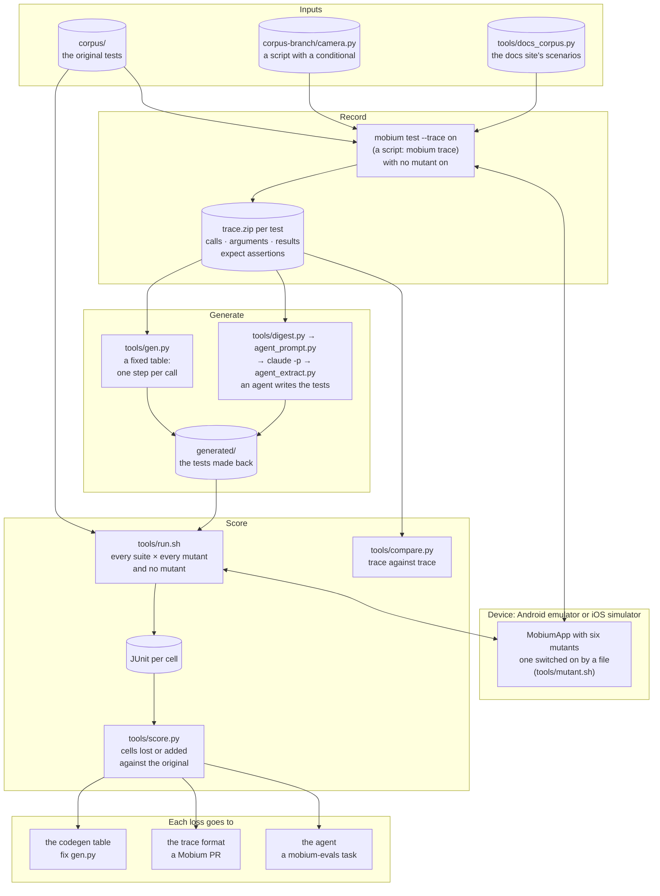

# mobium-roundtrip

A verification harness for [Mobium](https://github.com/mobiumdev/mobium)'s
traces, test runner and the agents that use them. It takes a test, records
what the test did on a device as a trace, turns that trace back into a test,
and then checks whether the regenerated test **catches the same bugs** as the
original. The device decides; no language model grades anything.

**New here? Start with [docs/ARCHITECTURE.md](docs/ARCHITECTURE.md)**: what
round-trip verification is, why it exists, how it works, what it is for, and
how it fits AI-native test automation, with diagrams.

Four probes have run, on Android and an iOS simulator. Their write-ups:

- [evidence/2026-10-14/RESULTS.md](evidence/2026-10-14/RESULTS.md) — probe 1, Android
- [evidence/2026-10-16/RESULTS.md](evidence/2026-10-16/RESULTS.md) — probe 2, Android: assertions, agents, a branch, the docs scenarios
- [evidence/2026-10-16-ios/RESULTS.md](evidence/2026-10-16-ios/RESULTS.md) — probe 3, the same round trip on an iOS simulator
- [evidence/2026-10-16-morpho/RESULTS.md](evidence/2026-10-16-morpho/RESULTS.md) — probe 4, Morpho Market's 25-test suite and its 16 bugs on both platforms
- [evidence/2026-10-17-morpho-reset/RESULTS.md](evidence/2026-10-17-morpho-reset/RESULTS.md) — probe 4's follow-up: `slow-catalog` after every reset, and the app's process id logged

## Contents

- [The idea](#the-idea)
- [Architecture](#architecture)
- [How it improves verification](#how-it-improves-verification)
- [What it has found](#what-it-has-found)
- [How a run works](#how-a-run-works)
- [Requirements](#requirements)
- [Reproducing a run](#reproducing-a-run)
- [What is in the repository](#what-is-in-the-repository)
- [Limits](#limits)
- [Not done](#not-done)
- [License](#license)

## The idea

A test exists in three forms:

| Form | What it holds | Where it is in Mobium |
|---|---|---|
| **Intent** | What the author meant to check | Test names, comments, the docs site's scenarios |
| **Code** | The steps and assertions the author wrote | `*.test.json` files, client scripts, `docs/checks/*.sh` |
| **Trace** | What actually happened on the device | `mobium trace`, `mobium test --trace on` (Vibium's record format) |

Going from code to a trace and back to code is a **round trip**:

```
original test ──run──▶ trace T ──generate──▶ new test ──run──▶ trace T′
```

If the trace recorded everything that mattered, the new test checks the same
things as the original. To find out, both tests run against copies of the app
with a **deliberate bug each** (mutants). A mutant the original catches and
the new test misses is information the round trip lost. Each loss lands in
one of three places:

1. **The codegen table is wrong.** Fix the generator.
2. **The trace is missing information.** Fix Mobium's trace format.
3. **An agent misread the trace.** Make it a task in the evaluation
   harness ([mobium-evals](https://github.com/mobiumdev/mobium-evals)).

## Architecture



The device is the only judge: a cell is a test failing under a mutant, read
from JUnit, and no model grades anything. [docs/ARCHITECTURE.md](docs/ARCHITECTURE.md)
takes each part in turn, with diagrams for how a verdict is reached and
where a difference goes.

## How it improves verification

Each point says what the harness measures and why that matters.

1. **It tests the trace, not only the app.** A trace is evidence: what a
   test did, kept for a person or an agent to read later. Until probe 1,
   nothing checked whether a trace was *complete*. A trace is complete enough
   when a test made from it catches the same bugs as the original. Probe 1
   found an `expect` recorded without its assertion. Probe 2 confirmed the
   fix: the lost cell came back.

2. **Mutants are the score, not pass/fail.** A replay with no assertions
   passes every time, so "the regenerated test passes" proves nothing. Six
   bugs, switched on at run time inside one build of MobiumApp, show which
   tests fail under each bug. Each mutant is also a positive control: a
   comparison that can never come back "different" is not a measurement.

3. **The device is the judge.** Scoring is two deterministic comparisons:
   which (mutant, test) cells fail, and whether two traces made the same
   calls with the same results. No language model grades anything. That
   matters here: in [mobium-rag](https://github.com/mobiumdev/mobium-rag), Haiku changed 8 of 20 scores when asked
   to rescore the same answers.

4. **It finds defects in Mobium that ordinary tests miss.** It drives the
   tool the way a generated test or an agent would, which is not the way its
   own checks do. Three defects so far: two in the trace (CHALLENGES 327) and
   one in scrolling (CHALLENGES 328), all fixed and merged
   (mobiumdev/mobium#219, #220).

5. **It measures agents on a checkable task.** An agent writes the test from
   traces, and the mutants score its work. In probe 2, Sonnet 5.5 and Haiku
   5.5 both recovered the original's structure and caught 12 of 12 cells.
   The branch case shows where agents go wrong in a way passing tests hide:
   both "solved" a conditional by removing it. That becomes an evaluation
   task rather than an opinion.

6. **It tells examples from tests.** The docs site's 13 scenarios replay
   perfectly but caught 1 of 6 mutants, by accident. They are examples, not
   tests. Without the mutant matrix the perfect replay would have looked
   like coverage.

## What it has found

| Finding | Probe | Bucket | Outcome |
|---|---|---|---|
| An `expect` was traced as a bare read, so a test made from the trace asserted nothing | 1 | trace | Fixed: CHALLENGES 327, mobiumdev/mobium#219 |
| The trace's help said typed text is not recorded; only a password is not | 1 | description | Fixed: CHALLENGES 327, #219 |
| A dialog that came up during a scroll was blamed on the list, and dialog rules never applied to scrolls | 2 | Mobium defect | Fixed: CHALLENGES 328, #220 |
| A trace keeps only one path through a conditional; each trace's test passes only in the state it was recorded in | 2 | inherent | Expected; a dialog rule (`app_dialogs`) can hold the "a dialog may come" kind of branch |
| Given two traces of a branching script, both agents granted the permission up front, which removes the branch instead of testing it | 2 | agent | To become a mobium-evals task |
| Typed text is not in a trace, only its length, so it must be supplied separately | 1 | by design | `tools/values.json`; passwords await ROADMAP's `secret:NAME` |
| iOS traces carry `driver` on every call, which `gen.py` copied into each step | 3 | codegen table | Fixed in `gen.py`; the iOS- and Android-generated tests are now byte-identical |
| The agents' "grant the camera first" is refused on an iOS simulator | 3 | agent | Their way of removing the branch is not portable; dialog rules are |
| "The app is in front throughout" checks only the first moment on iOS, where Settings arrives 0.9 s later | 3 | the original test | To tighten in Mobium's `tests/mobiumapp/` |
| On iOS, a scroll under an alert with no rule blamed the list (CHALLENGES 328's iOS twin) | 3 | Mobium defect | Fixed: CHALLENGES 330, #222 |
| On iOS, a keystroke is blamed when the app left the front | 3 | Mobium defect | Fixed: CHALLENGES 331, #223 |
| A test over 100 steps was refused at its first step (found by Morpho Market's TV test, not a probe) | — | Mobium defect | Fixed: CHALLENGES 329, #221 |

Scores. Android is the `mobium-test` emulator (Android 15); iOS is the
iPhone 17 Pro simulator (iOS 26.5). The original catches 12 cells on Android
and 11 on iOS (see the "in front" row above).

| Generated by | Android: caught / lost / extra | iOS: caught / lost / extra |
|---|---|---|
| `gen.py`, probe 1 (trace without assertions) | 11 / 1 / 0 | — |
| `gen.py`, trace with assertions | 12 / 0 / 0 | 11 / 0 / 0 |
| Sonnet 5.5, from the Android trace digests | 12 / 0 / 0 | 11 / 0 / 0 |
| Haiku 5.5, from the Android trace digests | 12 / 0 / 0 | 11 / 0 / 0 |

The agents' tests were written once, from Android traces, and run unchanged
on iOS.

## How a run works

1. **Corpus.** Mobium's own MobiumApp tests (`corpus/login.test.json`,
   `corpus/form.test.json`): 7 test entries, 9 tests once `each` is expanded.
   Also a client script with a conditional (`corpus-branch/camera.py`) and 13
   of the docs site's scenarios (`tools/docs_corpus.py`).
2. **Record.** Run the originals with `--trace on` on the build with no
   mutant. Each test leaves a `trace.zip`.
3. **Generate**, in one of two ways:
   - `tools/gen.py`, a fixed table with nothing inferred: one step per traced
     call, the runner's opening terminate and launch become the file's
     `app`, an `assertion` becomes an `expect`, and typed text becomes
     `${text_N}`, filled from `tools/values.json`.
   - An agent: `tools/digest.py` turns the traces into text (calls,
     arguments, results; no screenshots), `tools/agent_prompt.py` builds the
     prompt, `claude -p` answers, and `tools/agent_extract.py` writes the
     test files.
4. **Mutate.** One MobiumApp build carries six bugs, and a file in the
   app's data picks which one is on (`tools/mutant.sh`, written over `adb
   root` and read back). With no file the app behaves as shipped.

   | Mutant | The bug |
   |---|---|
   | `msg` | a wrong password's message reworded |
   | `terms-notify` | ticking Accept terms also ticks Email me |
   | `radio-sticky` | Free stays chosen when another plan is chosen |
   | `dark-stuck` | the dark mode switch cannot be turned off |
   | `logout-keeps` | the username field starts filled in |
   | `leaves-front` | the Login Demo opens Android's Settings over the app |

5. **Score.**
   - `tools/run.sh` runs every suite under every mutant, and under none.
   - `tools/score.py` compares failing cells. Under "none" both suites must
     pass, or nothing else in the table means anything.
   - `tools/compare.py` compares two runs' traces call by call, with
     timings, coordinates and refs taken out. Its positive control is one
     edited locator, reported as different (probe 1, `05-…`).

## Requirements

- macOS with the Android SDK at
  `ANDROID_HOME=/opt/homebrew/share/android-commandlinetools`, with
  `emulator` and `platform-tools` on `PATH`.
- The **`mobium-test` AVD**: Pixel 7, Android 15, `google_apis` image. The
  image matters, because `adb root` is how the mutant switch is written.
- For iOS: Xcode 26.6 with the iOS 26.5 runtime and the **iPhone 17 Pro
  simulator**. The switch is written into the app's data container on the
  Mac, so nothing like `adb root` is needed.
- **Mobium**, built from `~/mobium-public` (`make build`). The tools use
  `~/mobium-public/bin/mobium` unless `MOBIUM` names another binary. Probe 2
  ran on `76af755` plus the two fixes now merged as #219 and #220, so today's
  `main` includes everything probe 2 needed.
- **MobiumApp source** at `mobium-app` commit `0c6323f`
  (`~/mobium-app-public`), to build the mutant APK. The APKs are not in git
  (`app/build/` is ignored); see below.
- Python 3.9+ for the tools, and the Python client from
  `~/mobium-public/clients/python` for the branch script.
- For the agent step, the `claude` CLI. Probe 2 cost $0.09 (Sonnet) and $0.006
  (Haiku) for the corpus, and $0.11 and $0.006 for the branch.
- For the docs scenarios, `~/mobium-docs` (`examples/canonical.json`).

## Reproducing a run

The commands run from the repository root. `E` is a new evidence folder.

**1. Device and binary**

```sh
(cd ~/mobium-public && make build)
emulator -avd mobium-test -no-snapshot-load -no-boot-anim -no-window &
adb wait-for-device && adb -s emulator-5554 root
```

**2. The mutant build** (once; skip if `app/build/app-mutants.apk` exists)

```sh
cd ~/mobium-app-public && git checkout 0c6323f
git apply ~/mobium-roundtrip/app/mutants.patch   # or: python3 ~/mobium-roundtrip/app/mutate.py App.tsx
npx expo prebuild --platform android && npx expo run:android --variant release
cp android/app/build/outputs/apk/release/app-release.apk ~/mobium-roundtrip/app/build/app-mutants.apk
git checkout App.tsx && git checkout -   # the patch is never committed to mobium-app
cd ~/mobium-roundtrip && adb -s emulator-5554 install -r app/build/app-mutants.apk
tools/mutant.sh none
```

The probes' build has sha256 `ca02d729…`; a rebuild may differ in its bytes.
Keep the shipped build as `app/build/app-release-original.apk` to put back
afterward (step 7).

**3. Record, generate, score**

```sh
E=evidence/$(date +%F); mkdir -p $E
~/mobium-public/bin/mobium test --config cfg-corpus.json --trace on --reporter list,json --output $E/01-original-traced
T=$E/01-original-traced/artifacts/trace
python3 tools/gen.py generated/v2/login.test.json $T/android-login*/trace.zip --values tools/values.json
python3 tools/gen.py generated/v2/form.test.json  $T/android-form*/trace.zip  --values tools/values.json
SUITES="corpus generated-v2" tools/run.sh $E/03-matrix
SUITES="corpus generated-v2" python3 tools/score.py $E/03-matrix
```

A suite name is a config: `cfg-<suite>.json` names its test folder.

**4. An agent instead of the table**

```sh
python3 tools/agent_prompt.py corpus $T/*/trace.zip > agent/prompt-filled.md
claude -p --model sonnet --output-format json < agent/prompt-filled.md > agent/out-sonnet.json
python3 tools/agent_extract.py corpus agent/out-sonnet.json generated/agent-sonnet
SUITES="corpus generated-agent-sonnet" tools/run.sh $E/03-matrix
SUITES="corpus generated-agent-sonnet" python3 tools/score.py $E/03-matrix
```

Run `claude -p` from an empty folder, so the model cannot read the corpus.
The agent is given `agent/format.md`, not Mobium's test-runner guide: the
guide quotes the corpus, its Form Demo example word for word.

**5. The branch**

```sh
tools/branch.sh $E/07-branch     # the script in both permission states; a test from each trace in both
python3 tools/agent_prompt.py branch $E/07-branch/original-prompt.zip $E/07-branch/original-granted.zip > agent/branch-prompt-filled.md
claude -p --model sonnet --output-format json < agent/branch-prompt-filled.md > agent/branch-out-sonnet.json
python3 tools/agent_extract.py branch agent/branch-out-sonnet.json generated/branch/agent-sonnet.test.json
```

Then run each generated branch test after `mobium reset-permissions
dev.mobium.mobiumapp` (the prompt state) and after `mobium grant
dev.mobium.mobiumapp camera` (the granted state). `agent/tools.md` holds the
tool descriptions the agent was given; `tools/agent_prompt.py tools`
regenerates them from the binary, and today's differs only in `app_trace`'s
wording (#219).

**6. The docs scenarios**

```sh
mkdir -p $E/09-docs/original && python3 tools/docs_corpus.py $E/09-docs/original
D=$E/09-docs/original/artifacts/trace
python3 tools/gen.py generated/docs/settings.test.json \
  "$D/app_map[0]/trace.zip" "$D/app_text[0]/trace.zip" "$D/app_find[0]/trace.zip" "$D/app_tap[0]/trace.zip" \
  "$D/app_scroll_to[0]/trace.zip" "$D/app_swipe[0]/trace.zip" "$D/app_press[0]/trace.zip"
python3 tools/gen.py generated/docs/mobiumapp.test.json \
  "$D/app_scroll_to[1]/trace.zip" "$D/app_check[0]/trace.zip" "$D/app_wait_for[2]/trace.zip" \
  "$D/app_keyboard[0]/trace.zip" "$D/app_alert[1]/trace.zip" "$D/app_alert[2]/trace.zip"
~/mobium-public/bin/mobium test --config cfg-docs.json --trace on --reporter list,json --output $E/09-docs/generated
python3 tools/compare.py $E/09-docs/original $E/09-docs/generated
```

`gen.py` takes traces of one app per file, so Settings and MobiumApp get one
each. For the mutants, run `generated/docs/mobiumapp.test.json` after
`tools/mutant.sh <mutant>` for each of the six.

**iOS.** The same steps with the simulator's UDID. Build the mutant app with
`xcodebuild -workspace ios/MobiumApp.xcworkspace -scheme MobiumApp
-configuration Release -sdk iphonesimulator -destination id=<udid> build` in
`~/mobium-app-public` after applying the patch, and keep the
`MobiumApp.app` as `app/build/ios-mutants.app`. Back up the installed app
first (`xcrun simctl get_app_container <udid> dev.mobium.mobiumapp app`).
Then use the `cfg-ios-*.json` configs, and give `run.sh` the device:

```sh
DEV=<udid> SUITES="ios-corpus ios-generated-ios-v2" tools/run.sh $E/03-matrix
SUITES="ios-corpus ios-generated-ios-v2" python3 tools/score.py $E/03-matrix
python3 corpus-branch/camera.py $E/07-branch/original-prompt.zip <udid>
```

`mobium grant … camera` is refused on a simulator; the granted state comes
from answering the prompt's Allow once.

**7. Put the device back**

```sh
adb -s emulator-5554 install -r app/build/app-release-original.apk   # the shipped build
(cd ~/mobium-public && sh docs/checks/clean-stop.sh --quit)
```

## What is in the repository

| Path | What it is |
|---|---|
| `corpus/` | The original MobiumApp tests (identical to Mobium's `tests/mobiumapp/`) |
| `corpus-branch/camera.py` | The branch case: a Python client script with a conditional |
| `generated/` | Tests generated from traces: `novalues`, `withvalues` (probe 1), `v2` (with assertions), `agent-sonnet`, `agent-haiku`, `branch/` (each trace's test, both agents', and the hand-written dialog rule), `docs/` |
| `cfg-*.json` | One `mobium test` config per suite |
| `tools/` | `gen.py`, `digest.py`, `agent_prompt.py`, `agent_extract.py`, `run.sh`, `mutant.sh`, `score.py`, `compare.py`, `branch.sh`, `docs_corpus.py`, `values.json` |
| `app/` | `mutate.py` and `mutants.patch`, which add the six mutants to MobiumApp's `App.tsx`; `build/` (ignored) holds the APKs |
| `agent/` | The prompt template, the format reference written for the agent, the tool list, the filled prompts, and each model's raw answer with its cost |
| `evidence/<date>/` | Each probe's `RESULTS.md`, with the JUnit result of every run, the scores and the short outputs it cites. The traces, screenshots, HTML reports and logs are not kept here (about 420 MB); the commands under "Reproducing a run" make them again |

## Limits

- **Two devices, one app.** Everything ran on one Android 15 emulator and
  one iOS 26.5 simulator against MobiumApp's Login, Form and Dialog Demos,
  and Settings for the docs scenarios (Android only). Nothing has run on a
  phone.
- **A small corpus.** Nine tests and six mutants. A real suite has more ways
  to lose information than this one exercised.
- **One agent run per model.** Agents vary between runs, and this corpus is
  easy: the test titles say which tests share a file, and the `each` cases
  are named in them.
- **The mutants are written by hand**, each a plausible bug in a screen the
  corpus covers. They show what a suite catches, not what it would catch in
  the wild.
- **Typed text must be supplied.** A trace keeps only its length, so a
  regenerated test is not runnable from the trace alone.

## Not done

- An evaluation task from the branch result, scored on whether the prompt
  path is still tested, not only on passing in both states.
- Several agent runs per model, on a corpus whose titles do not give the
  grouping away.
- Assertions for the docs scenarios, so they count as tests.
- The iOS lead in Mobium: a keystroke blamed for an app that left the front.
- A real iPhone.

## License

Apache License 2.0; see [LICENSE](LICENSE) and [NOTICE](NOTICE).
