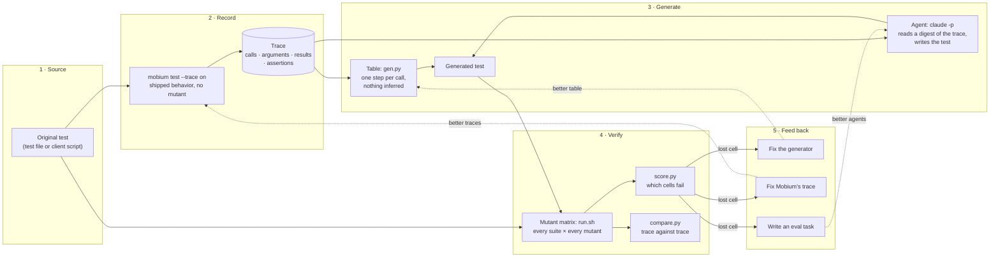
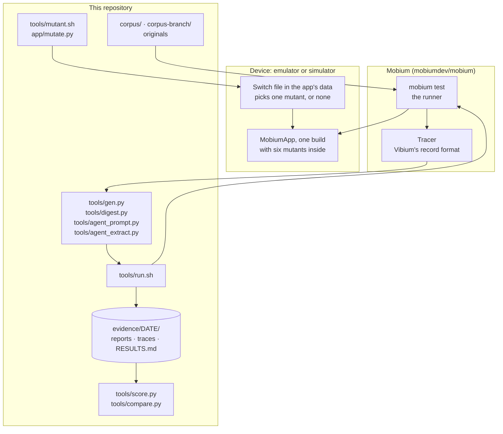
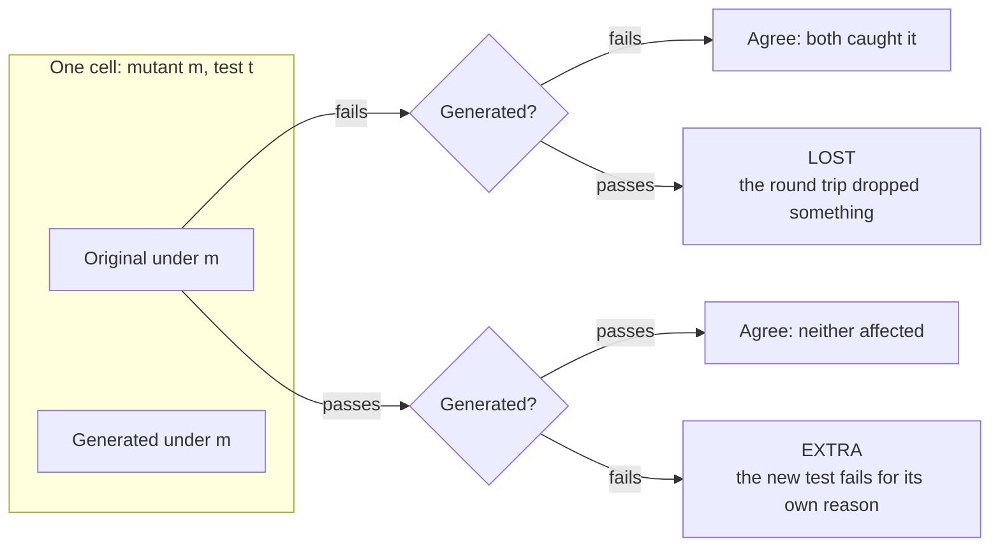
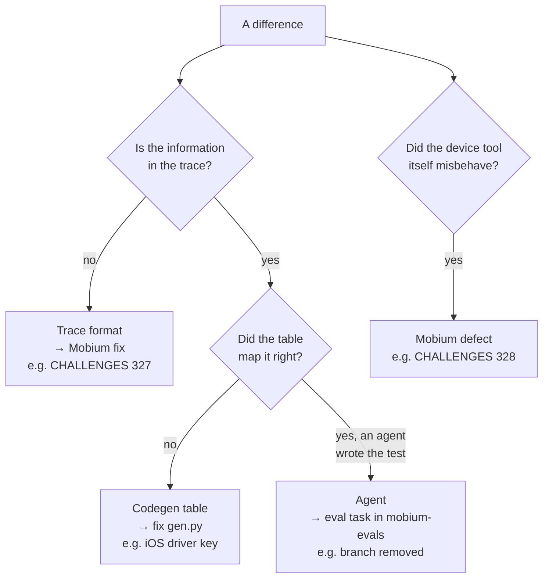
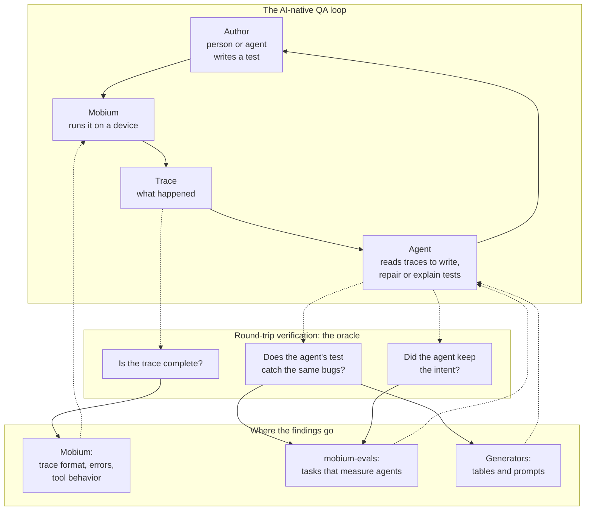

# Round-trip verification: architecture

This document explains what round-trip verification is, why it exists, how
it works, and what it is for. It also places it in an AI-native test
automation practice, where agents write and repair tests as well as people.
The [README](../README.md) has the commands and the results; this is the
reasoning behind them.

## Contents

- [In one paragraph](#in-one-paragraph)
- [The problem it answers](#the-problem-it-answers)
- [The architecture](#the-architecture)
- [The parts, one by one](#the-parts-one-by-one)
- [How a verdict is reached](#how-a-verdict-is-reached)
- [Where a difference goes](#where-a-difference-goes)
- [How it fits AI-native test automation](#how-it-fits-ai-native-test-automation)
- [Design decisions](#design-decisions)
- [What it does not do](#what-it-does-not-do)
- [Glossary](#glossary)

## In one paragraph

A test runs on a device and leaves a **trace**: every call it made and what
the device answered. Round-trip verification turns that trace back into a
test, by a fixed table or by an AI agent, and then asks one question: **does
the new test catch the same bugs as the original?** To answer it, both tests
run against copies of the app that each contain one deliberate bug. If the
original fails on a bug and the new test passes, something was lost on the
way, and the place it was lost names the part to fix: the trace format, the
generator, or the agent. The device decides every verdict; no language model
grades anything.

## The problem it answers

Mobium records traces so that a person or an agent can later read what a
test did. In an AI-native practice, agents go further: they read traces to
write new tests, repair broken ones and explain failures. All of that rests
on two assumptions nobody had checked:

1. **The trace holds what matters.** If a trace drops an assertion, every
   test made from it checks less than the original, and nothing says so.
2. **A test that passes is a test that works.** A generated test with no
   assertions passes every time. Passing is the weakest possible evidence.

Neither can be checked by reading. The first probe found a trace that
recorded an `expect` as a plain read, with its assertion gone (CHALLENGES
327). It had been that way since traces existed, and the trace looked
complete. The only way to tell is to use the trace, the way an agent would,
and measure what the result can still catch.

## The architecture

Read left to right:

1. **Source.** A test whose intent is known, because a person wrote it and
   it is known to work.
2. **Record.** It runs once on the real app with tracing on, and leaves one
   trace per test.
3. **Generate.** The trace becomes a test again, by a deterministic table or
   by an agent.
4. **Verify.** The original and the generated test run side by side under
   every deliberate bug. Two comparisons follow: which (bug, test) cells
   fail, and whether the two traces made the same calls.
5. **Feed back.** Every difference is assigned to the part that caused it.
   The fix improves that part, and the next round measures it again.

The dotted arrows are the point: this is a loop, not a one-off report.

## The parts, one by one

| Part | What it does | Why it is built this way |
|---|---|---|
| **Corpus** (`corpus/`, `corpus-branch/`) | The originals: Mobium's own MobiumApp tests, and a client script with a conditional | The intent has to be known before anything can be said about whether it survived |
| **Tracer** (in Mobium) | Records each call: tool, arguments, result, the screen after it, and since #219 what an `expect` asserts | The thing under test. A gap here is a gap for every reader of every trace |
| **Table generator** (`tools/gen.py`) | One step per traced call; drops what the runner adds (device, driver); turns an `assertion` back into an `expect`; leaves a placeholder for typed text | A baseline with no judgment in it. Whatever it loses, the trace lost |
| **Agent generator** (`digest.py`, `agent_prompt.py`, `claude -p`, `agent_extract.py`) | Gives a model the trace as text and a format reference, and writes its answer out as test files | Tests what a table cannot do: recover structure (shared setup, cases over data, assertions) and intent |
| **Mutants** (`app/mutate.py`, `tools/mutant.sh`) | Six plausible bugs compiled into one build; a file in the app's data turns one on. Morpho Market (probe 4) has 16 of its own, switched by a deep link | One build means the only thing that changes between runs is the bug. The switch is read back, never assumed |
| **Matrix** (`tools/run.sh`, `tools/morpho_run.sh`) | Runs each suite under each mutant and under none | The no-mutant run is the control: if anything fails there, nothing else in the table means anything |
| **Scoring** (`tools/score.py`, `tools/compare.py`) | Compares failing cells; compares traces call by call with timings, coordinates and refs normalized | Both comparisons are mechanical, and both have a positive control that shows they can say "different" |
| **Evidence** (`evidence/<date>/`) | Every report, trace, log and score, and a `RESULTS.md` | A claim here has to be re-checkable from what is kept |

## How a verdict is reached

The matrix is a grid: one row per (mutant, test), one column per suite.

- **Lost** is the cell that matters: a bug the original catches and the
  regenerated test cannot.
- **Extra** is the opposite: the generated test fails for a reason of its
  own, a brittle step or a wrong value.
- A run with no mutant must pass in both columns, or the matrix is void.

Agreement on cells is not enough on its own, so failure messages are
compared too. In probe 2 the regenerated test failed under `leaves-front`
with the original's message word for word. It failed on the same assertion,
not by accident.

Not every source has assertions to score. The docs site's scenarios are one
command each with no check, and they replayed perfectly (13 of 13 the same
calls). They caught 1 of 6 mutants, by accident. A perfect replay of
something that checks nothing still checks nothing. That is why replay is
the weakest of the three levels:

| Level | Question | How it is answered | Strength |
|---|---|---|---|
| Replays | Did the new test do the same things? | `compare.py`, trace against trace | Necessary, weak: a test with no assertions replays perfectly |
| Catches the same bugs | Does it fail where the original fails? | the mutant matrix | The score that counts |
| Matches the intent | Does it check what the author meant? | structure compared by hand (shared setup, cases, assertions, names) | Strongest, and the only level that may one day need a judge |

## Where a difference goes

Every lost cell, failure or oddity goes to exactly one owner:

The routing is what turns a score into work. A lost cell is not "the round
trip is 92% good". It is one named defect with one owner.

So far:

| Found | Owner | Status |
|---|---|---|
| `expect` traced without its assertion | trace | fixed, mobiumdev/mobium#219 |
| Help promised typed text was not recorded | trace description | fixed, #219 |
| A dialog mid-scroll blamed on the list | Mobium | fixed, #220 |
| The same on iOS, under an alert | Mobium | fixed, #222 |
| A keystroke blamed for an app that left the front | Mobium | fixed, #223 |
| iOS traces carry `driver` on every call | codegen table | fixed in `gen.py` |
| Agents meet a conditional by removing it | agent | to become an eval task |
| An agent's `each` changed a test's meaning, and no bug noticed (probe 4) | agent / the bug set | to become a mutant and an eval task |
| A Morpho Market test's verdict under `slow-catalog` depends on a new process (probe 4) | the original test | fixed in Morpho Market; re-run 0 lost |
| `score.py` let one `each` case overwrite another | the scorer | fixed; probes 2 and 3 unchanged |

## How it fits AI-native test automation

In an AI-native practice, test automation is no longer only code people
write and maintain. Agents take part in every stage: they explore an app,
write tests, repair the ones a change broke, and explain failures. The
artifacts they work from are the same ones people use: tests, traces,
screenshots, error messages. Round-trip verification is the part of that
practice that checks the artifacts and the agents.

Four things it adds to such a practice:

1. **An oracle for agent-written tests.** An agent's test that passes proves
   little. Run against deliberate bugs, it either catches what a known-good
   test catches or it does not, and the cells say which. In probe 2, Sonnet
   5.5 and Haiku 5.5 each caught 12 of 12 from traces alone. Given a
   conditional, both removed it, which passing tests would never have shown.

2. **A test of the trace as an agent interface.** A trace is what an agent
   is handed when it is asked "what did this test do?" If the trace drops
   something, every agent downstream works from less, and is wrong in the
   same way. The round trip measures the trace by what can be rebuilt from
   it, which is exactly how an agent uses it.

3. **Grading without a model.** Many AI evaluation setups use a language
   model as the judge. Here the device decides, through cells that fail or
   pass. That matters because model judges drift: in the RAG work beside
   this project, Haiku changed 8 of 20 scores when asked to rescore the same
   answers. A model would be needed only at the last level, intent in
   prose, and only after it passes controls of its own.

4. **Labeled data as a by-product.** Every round produces (trace, original
   test, generated test, verdict) with the verdict checked on a device. That
   is the material for evaluation tasks now, and for fine-tuning if it ever
   makes sense.

It also keeps people in the loop. Agents generate; people own the mutants
(what a bug looks like), the originals (what was meant) and the routing of
each finding. Those are the judgments a machine is least able to check.

## Design decisions

| Decision | Why | What it rules out |
|---|---|---|
| **Mutants are the score, not pass/fail** | A replay with no assertions passes every time | Counting passing tests as success |
| **One build with all mutants, chosen at run time** | The only variable between runs is the bug; no rebuild per mutant | Comparing runs of different builds |
| **The switch is read back after every write** | Every device tool here reports success it did not achieve (Mobium's own rule) | A mutant run that silently ran the shipped app |
| **A no-mutant control in every matrix** | If a suite fails without a bug, its other cells mean nothing | Scoring a broken suite |
| **Positive controls for each comparison** | A comparison that cannot say "different" measures nothing | Trusting a clean result on faith |
| **A deterministic table beside the agent** | Separates what the trace lost from what the agent lost | Blaming the agent for a trace gap, or the reverse |
| **The agent never sees the corpus** | Mobium's own guide quotes the corpus, so it was replaced by a format reference written for the probe, and the agent runs in an empty folder | An agent "recovering" what it was shown |
| **Every finding goes to one owner** | A score with no owner is not acted on | Percentages instead of fixes |
| **Evidence is kept, not summarized away** | Every claim in a write-up can be re-checked | Results nobody can reproduce |

## What it does not do

- **It does not find bugs in the app under test.** The mutants are planted;
  the point is to measure the tests, the trace and the agents.
- **It does not prove a suite is complete.** Six mutants show what these
  tests catch among six bugs, not everything they would catch.
- **It does not judge intent automatically.** Structure is compared by hand;
  a model judge, if one is added, must pass its own controls first.
- **It does not replay typed secrets.** A trace keeps only a typed text's
  length, by design, so values are supplied separately (passwords will use
  Mobium's planned `secret:NAME` reference).
- **It is small so far.** One app, nine tests, six mutants, Android and an
  iOS simulator, one agent run per model.

## Glossary

| Term | Meaning |
|---|---|
| **Trace** | Mobium's record of a session: each call's tool, arguments, result, the screen after it, and an `expect`'s assertion. Vibium's record format, opened by player.vibium.dev |
| **Round trip** | Test → run → trace → generated test → run → trace |
| **Mutant** | A copy of the app's behavior with one deliberate bug, switched on at run time |
| **Cell** | One (mutant, test) pair: did each suite fail or pass? |
| **Lost cell** | The original failed and the generated test passed: the round trip lost a check |
| **Extra cell** | The generated test failed where the original passed |
| **Positive control** | A case built to come back "different", proving a comparison can |
| **Table** | `gen.py`: the fixed mapping from trace to test, with no inference |
| **Digest** | A trace as text for an agent: calls, arguments, results, no screenshots |
| **Intent** | What the author meant to check; held in names, structure and assertions |
